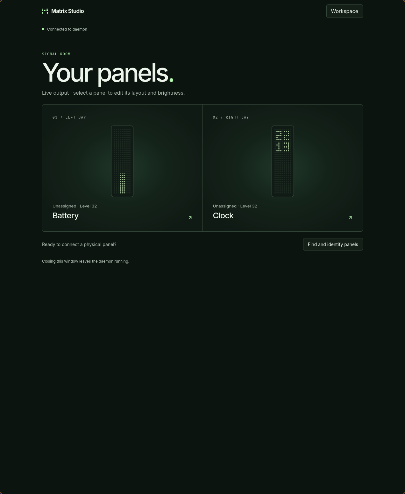

# Matrix Studio

Matrix Studio configures one or two Framework Laptop 16 LED Matrix modules on
Linux. Give each panel its own clock, battery gauge or brightness setting, and
preview a layout before saving it. Close the desktop and the daemon keeps the
panels running. No assistant account is required.

## Try it on Linux

**Development preview:** unsigned x86-64 Arch/CachyOS package candidates are
available from the [Arch package workflow](https://github.com/jschraub/fw16-ledmatrix/actions/workflows/arch-package.yml).
There is no stable release, AUR entry, or Debian/Ubuntu package from this project yet.

1. Follow the [package guide](docs/PACKAGING.md) to download, verify and install
   a candidate. If you previously used the Python prototype, follow the
   [migration guide](docs/MIGRATION.md) first so only one daemon owns the panels.
2. Launch **Matrix Studio** from the application menu. Start the daemon if
   prompted. Open **Workspace → Devices** to identify the panels, then choose
   **Assign panels to sides** and save the assignments.
3. Return to **Overview**, choose a panel and try a layout. On-screen changes
   are a draft; hardware preview is temporary. Choose **Save changes** to keep it.

Clock, battery, brightness and charging effects work independently of assistant
integrations. To add session activity or usage windows, see
[optional integrations](docs/INTEGRATIONS.md).

## Compatibility and support

Two-panel hardware testing has been performed on CachyOS with Hyprland.
Ubuntu CI builds and hardware-free tests do not establish USB or desktop
support there. Windows is not a v1 target. USB reconnect and full-day soak
qualification are still open; **do not remove a module from a running laptop
to troubleshoot**. Removal interrupted keyboard and touchpad input in testing.
See [tested behavior and known limits](docs/SUPPORT.md).

For a bug, open an [issue](https://github.com/jschraub/fw16-ledmatrix/issues)
with the package version, distribution, and steps to reproduce. If diagnostics
would help, use **Workspace → Diagnostics → Generate redacted report** and
review it before sharing. Keep credentials, raw logs and client settings private.

## Development

You can [run the Rust daemon and Tauri desktop without panels](docs/DEVELOPMENT.md).
See the [widget guide](docs/WIDGETS.md), [design audit](docs/design/workspace-audit.md),
and [v1 roadmap](https://github.com/jschraub/fw16-ledmatrix/issues/1).
The [Python prototype](poc/README.md) is historical reference, not an install
or recovery path.

Independent community project, not an official Framework product. [MIT license](LICENSE).
