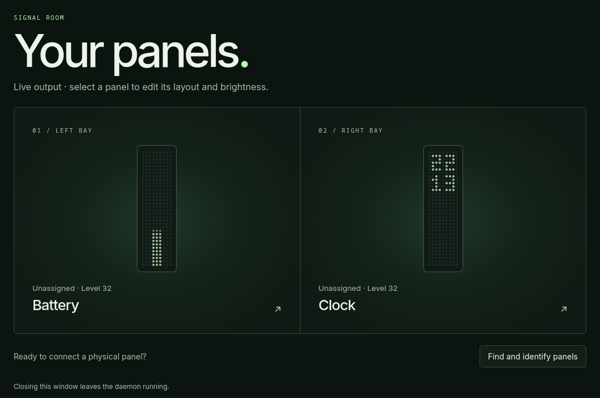

# Matrix Studio

Matrix Studio configures one or two Framework Laptop 16 LED Matrix modules on
Linux. Give each panel its own clock, battery gauge or brightness setting, and
preview a layout before saving it. Close the desktop and the daemon keeps the
panels running. No assistant account is required.

## Key features

- **Claude and OpenAI subscription usage:** Show how much of your five-hour or
  weekly allowance you’ve used, when the provider supplies that window. Polling
  is opt-in: Claude uses your local Claude Code login and OpenAI uses your
  OpenCode login. OpenAI weekly usage has been verified on a physical panel;
  Claude usage has been tested with simulated provider responses.
  [Set up subscription usage](docs/INTEGRATIONS.md#account-usage-windows-linux).
- **Assistant session activity:** See how much context a session is using or
  whether it’s busy. The [Claude Code helper](docs/INTEGRATIONS.md#claude-code-rust-helper)
  and [OpenCode plugin](docs/INTEGRATIONS.md#opencode-v2-producer) share session
  metadata, not conversation text. Session activity works independently of
  subscription polling.
- **Independent panel layouts:** Put a clock and battery bar on one side and a
  weekly usage gauge on the other. Try a draft on the physical panels for ten
  seconds before deciding whether to save it.
- **Brightness and feedback:** Set brightness per panel or follow the display.
  Show a charging pulse or briefly replace a layout with a volume or brightness
  gauge, then let the usual content return.

## Try it on Linux

Check [GitHub Releases](https://github.com/jschraub/fw16-ledmatrix/releases)
for published Arch/CachyOS x86-64 packages and verification instructions.
Unsigned development candidates are available separately from the
[Arch package workflow](https://github.com/jschraub/fw16-ledmatrix/actions/workflows/arch-package.yml).

1. Follow the [package guide](docs/PACKAGING.md) to download, verify and install
   a candidate. If you previously used the Python prototype, follow the
   [migration guide](docs/MIGRATION.md) first so only one daemon owns the panels.
2. Launch **Matrix Studio** from the application menu. Start the daemon if
   prompted. Open **Workspace → Devices** to identify the panels, then choose
   **Assign panels to sides** and save the assignments.
3. Return to **Overview**, choose a panel and try a layout. On-screen changes
   are a draft; hardware preview is temporary. Choose **Save changes** to keep it.

## Compatibility and support

Two-panel hardware testing has been performed on CachyOS with Hyprland.
Ubuntu CI builds and hardware-free tests do not establish USB or desktop
support there. Windows is not a v1 target. Hot-swap recovery has not been
qualified; **do not remove a module from a running laptop
to troubleshoot**. Removal interrupted keyboard and touchpad input in testing.
See [tested behavior and known limits](docs/SUPPORT.md).

Have a setup question or want help with a panel? [Ask in Q&A](https://github.com/jschraub/fw16-ledmatrix/discussions/categories/q-a).
To suggest a widget, layout, or workflow, [share it in Ideas](https://github.com/jschraub/fw16-ledmatrix/discussions/categories/ideas).

For a bug, open an [issue](https://github.com/jschraub/fw16-ledmatrix/issues)
with the package version, distribution, and steps to reproduce. If diagnostics
would help, use **Workspace → Diagnostics → Generate redacted report** and
review it before sharing. Keep credentials, raw logs and client settings private.

## Development

You can [run the Rust daemon and Tauri desktop without panels](docs/DEVELOPMENT.md).
See the [widget guide](docs/WIDGETS.md), [design audit](docs/design/workspace-audit.md),
and [v1 roadmap](https://github.com/jschraub/fw16-ledmatrix/issues/1).
The [Python prototype](poc/README.md) is historical reference, not an install
or recovery path.

Independent community project, not an official Framework product. [MIT license](LICENSE).
